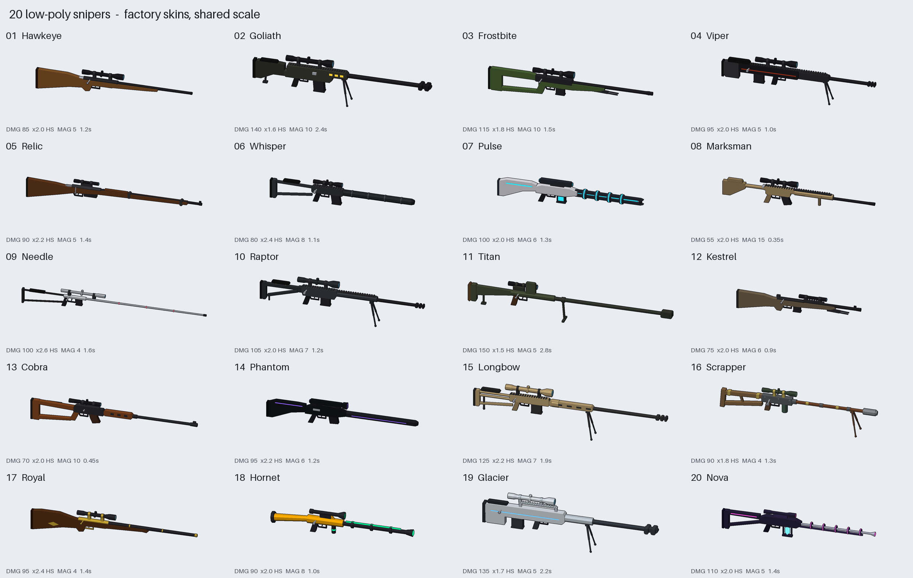
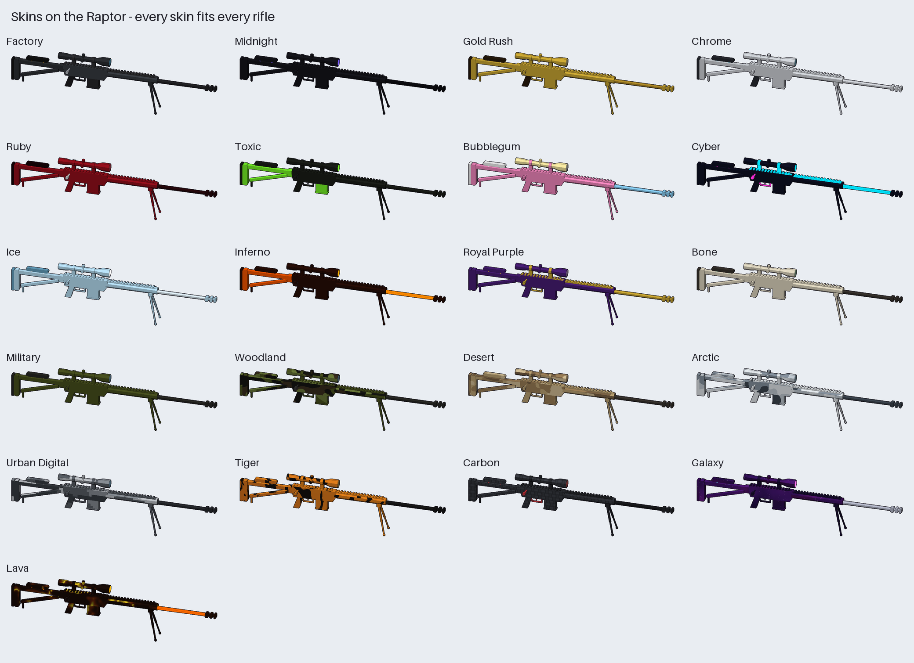
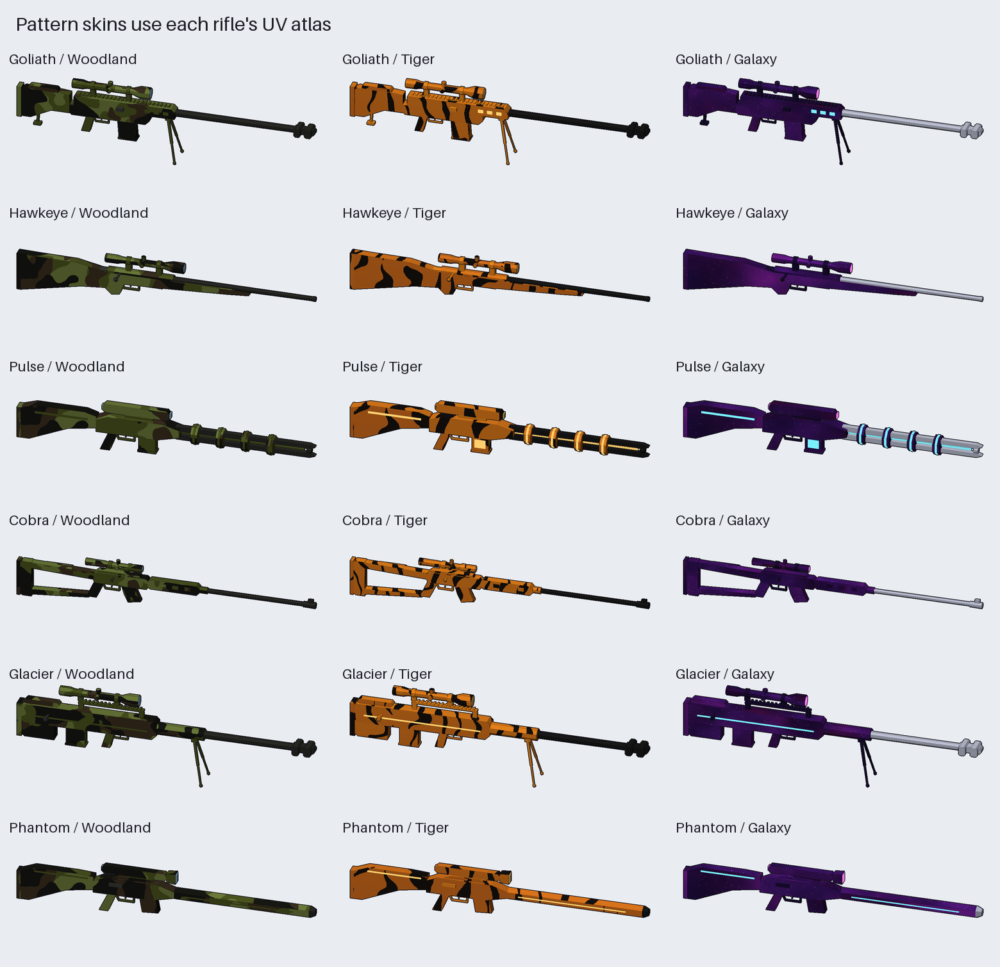

# Roblox low-poly snipers

These are 20 low-poly sniper rifles for a Roblox sniper-arena game. Every rifle is split into the
same named parts, so **any skin fits any rifle**.



| # | Rifle | Style | Dmg | HS× | Mag | Shot delay |
|---|-------|-------|-----|-----|-----|-----------|
| 1 | Hawkeye | Classic walnut bolt-action | 85 | 2.0 | 5 | 1.2s |
| 2 | Goliath | .50 anti-materiel, bipod, big brake | 140 | 1.6 | 10 | 2.4s |
| 3 | Frostbite | Arctic-warfare thumbhole | 115 | 1.8 | 10 | 1.5s |
| 4 | Viper | Bullpup | 95 | 2.0 | 5 | 1.0s |
| 5 | Relic | Vintage, side scope, barrel bands | 90 | 2.2 | 5 | 1.4s |
| 6 | Whisper | Integrally suppressed | 80 | 2.4 | 8 | 1.1s |
| 7 | Pulse | Sci-fi railgun | 100 | 2.0 | 6 | 1.3s |
| 8 | Marksman | Semi-auto DMR | 55 | 2.0 | 15 | 0.35s |
| 9 | Needle | Ultra-long featherweight | 100 | 2.6 | 4 | 1.6s |
| 10 | Raptor | Tactical chassis, folding stock | 105 | 2.0 | 7 | 1.2s |
| 11 | Titan | Anti-tank, top mag, offset scope | 150 | 1.5 | 5 | 2.8s |
| 12 | Kestrel | Short scout rifle | 75 | 2.0 | 6 | 0.9s |
| 13 | Cobra | Semi-auto, open wood stock | 70 | 2.0 | 10 | 0.45s |
| 14 | Phantom | Faceted stealth, hex shroud | 95 | 2.2 | 6 | 1.2s |
| 15 | Longbow | Extreme-range, monopod | 125 | 2.2 | 7 | 1.9s |
| 16 | Scrapper | Junkyard pipe-and-plank | 90 | 1.8 | 4 | 1.3s |
| 17 | Royal | Gold & walnut safari | 95 | 2.4 | 4 | 1.4s |
| 18 | Hornet | Chunky yellow plasma | 90 | 2.0 | 8 | 1.0s |
| 19 | Glacier | Anti-materiel bullpup | 135 | 1.7 | 5 | 2.2s |
| 20 | Nova | Crystal-powered laser | 110 | 2.0 | 5 | 1.4s |

The stats are starting points for balancing. They also include reload time, zoom FOV, bullet
speed and walk speed; you'll find them all in `roblox/SniperData.lua`.

## What's here

```
models/obj/<Rifle>.obj/.mtl   one object per part; import these into Roblox Studio
models/glb/<Rifle>.glb        the same rifles as glTF, for Studio or Blender
templates/<Rifle>_uv.png      UV layout for painting a custom skin
textures/*.png                pattern textures for the camo/pattern skins
previews/                     renders: every rifle, every skin
roblox/                       Luau: skin system, tool builder, data, example
tools/                        Python generator (regenerates everything)
```

Each rifle has 344 to 1,384 triangles and is 4.5 to 7.5 studs long. Units are studs, Y is up,
and the muzzle points down **-Z** (Roblox's LookVector).

## Skin slots

Every rifle uses these part names (only the ones it needs):

`Body` `Stock` `Pad` `Grip` `Barrel` `Handguard` `Muzzle` `Scope` `Lens` `Mount` `Magazine`
`Bolt` `Trigger` `Bipod` `Accent`

A skin is a colour and material per slot, plus an optional texture. `Default` covers every slot
the skin doesn't name. `Lens` and `Accent` (glass and glowing bits) keep the rifle's own look
unless the skin sets them.



It comes with 20 skins: Midnight, Gold Rush, Chrome, Ruby, Toxic, Bubblegum, Cyber, Ice, Inferno,
Royal Purple, Bone, Military, and the pattern skins Woodland, Desert, Arctic, Urban Digital,
Tiger, Carbon, Galaxy and Lava. `Factory` gives each rifle its original colours back.



### How the textures work

Each rifle has **one shared UV atlas**. Every part's faces are laid flat (side / top / front
views) at the same studs-per-pixel scale, so:

- **Pattern skins** (camo etc.) look evenly sized across the whole gun, and one texture works
  on every rifle.
- **Hand-painted skins**: open `templates/<Rifle>_uv.png` in any paint program, paint over it,
  upload it, and register it as an `Atlas` skin (see below). Every part of that rifle uses the
  same image. The left and right sides share the side view, so a design shows up mirrored on
  both sides.

## Setting it up in Roblox Studio

1. **Import the meshes.** Use *Home → Import 3D* (3D Importer) and pick
   `models/obj/<Rifle>.obj`, or the `.glb`. Keep the parts **separate** (don't merge meshes);
   the separate parts are what make skins work. The result should be a Model containing
   MeshParts named `Body`, `Stock`, `Barrel` and so on.
   - Check that the size is about 5–7 studs long and the barrel points along -Z. If your
     importer flips or rescales it, fix the importer's scale and orientation settings and
     import again. The Luau assumes the parts aren't rotated inside the model.
   - If the importer adds prefixes like `Hawkeye_Body`, the skin system still finds the slot.
     You can also set a `Slot` attribute on a part.
2. Rename each Model to the rifle name (`Hawkeye`, `Goliath`, …) and put them all in a Folder at
   **`ReplicatedStorage.Snipers`**.
3. Add each file in `roblox/` as a **ModuleScript** in `ReplicatedStorage`, named after the
   file without `.lua`: `SniperData`, `SkinCatalog`, `TextureIds`, `SniperSkins`, `SniperKit`.
4. Optional: put `GiveSnipers.server.lua` in `ServerScriptService` as a Script. It gives each
   player a random rifle in a random skin, so you can test right away.
5. For the pattern skins, upload the PNGs in `textures/` (Asset Manager → Bulk Import) and paste
   each asset id into `TextureIds`. Until you do, pattern skins fall back to their colours.

### Using it

```lua
local RS = game:GetService("ReplicatedStorage")
local SniperKit = require(RS.SniperKit)
local SniperSkins = require(RS.SniperSkins)

-- a ready-to-hold Tool: skin applied, Handle at the grip, everything welded,
-- Muzzle/Aim/Grip attachments added, stats copied onto attributes
local tool = SniperKit.BuildTool(RS.Snipers.Raptor, "Galaxy")
tool.Parent = player.Backpack

SniperKit.SetSkin(tool, "Gold Rush")               -- re-skin later (e.g. from a shop)
local origin, direction = SniperKit.GetMuzzle(tool) -- where your bullet raycast starts
print(tool:GetAttribute("Damage"), tool:GetAttribute("ZoomFOV"))

-- your own skins
SniperSkins.Register("Dragon", {
	Default = { Color = Color3.fromRGB(40, 8, 8), Material = Enum.Material.SmoothPlastic },
	Barrel  = { Color = Color3.fromRGB(255, 90, 0), Material = Enum.Material.Neon },
})
-- a skin painted on templates/Raptor_uv.png
SniperSkins.Register("Raptor Graffiti", { Atlas = { Raptor = "rbxassetid://YOUR_ID" } })
```

The `Aim` attachment sits where the player's eye goes behind the scope, which is handy for
first-person scoping. If a rifle sits wrong in the hand, change `SniperKit.Grip`.

## Regenerating

You only need this if you want to change the models. Everything is code: the shapes are in
`tools/rifles.py`, the skins in `tools/skins.py` and the shared parts in `tools/lowpoly.py`.
Then run:

```
pip install numpy pillow
python3 roblox-snipers/tools/build.py
```

The script rebuilds every model, template, texture, preview, `SniperData.lua` and
`SkinCatalog.lua`.
